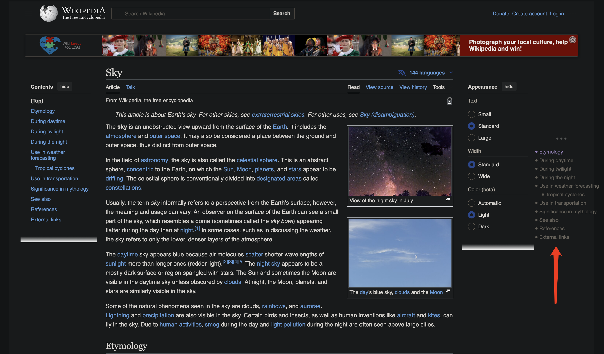

# auto-toc

Displays a table of contents for any website, making it easier to read and navigate long articles, documentations, and online books.

Generate TOC(table of contents) for any website. 可以为任何网站生成TOC网站目录大纲.

# 高级技巧Advanced Skills 

# Features

- Work properly on any website that conforms to the HTML standard and uses HTML heading tags properly (e.g. Wikipedia.com). 
- Accurate article and heading detection
- A clean user interface
- Highlight current heading
- Click to jump to headings
- Drag the panel to your preferred position
- Only runs when you actually use it
- Dark mode, automatically
- 6 heading levels
- Expand all headings to a specific level
- Support HTML label:
  - `H1`, `H2`, `H3`, `H4`, `H5`, `H6`
  - `<strong>`
  - `<b>`
- Anti-Google-Redirect
- Anti-Jumping-Warnings
- Hide-Zhihu-Top-Bar-When-Scrolling-Down
- Touch-Fish(Shrink IMG)

# Installation & Usage

- English: https://greasyfork.org/en/scripts/458022-auto-toc?locale_override=1
- 中文: https://greasyfork.org/zh-CN/scripts/458022-auto-toc?locale_override=1

By default, TOC is enabled on all websites. Sites where a legacy saved preference explicitly disables TOC remain disabled.

可以为任何网站生成TOC网站目录大纲, 默认是不打开的, 需要去插件菜单里为想要打开 toc 的网站开启开关, 插件会记住这个开关, 下回再打开这个网站会自动根据开关来生成 toc 与否.

<!-- 
# 捐赠

捐赠! 让作者更有动力给 auto-toc 加新功能! ^_^
